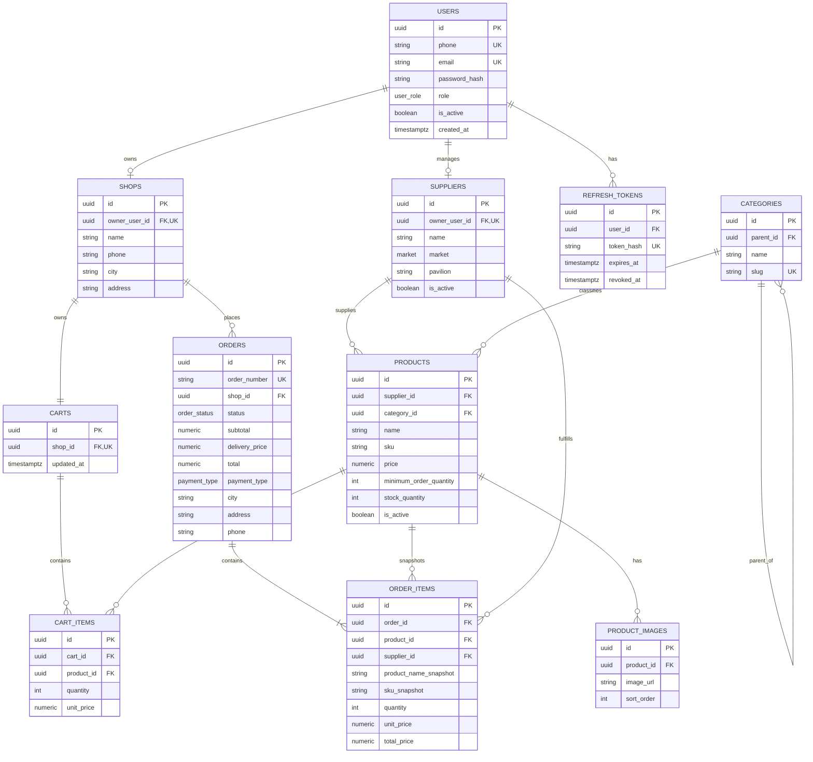

# Архитектура MVP B2B Marketplace

## Stage 5.5: implemented modular monolith

Backend остаётся единым FastAPI-приложением с одной PostgreSQL, но код организован по business domains: `auth`, `users`, `shops`, `suppliers`, `catalog`, `cart`, `orders`, `delivery`. Общая конфигурация, security primitives, exceptions, enums, database session и Alembic metadata находятся в `core` и `db`.

Направление зависимостей: `router -> service -> repository/model`. Router отвечает за HTTP, auth dependencies, response model и status code; service — за business rules и transaction workflows. Repository используется только для сложных catalog/order queries и locking. Domain не импортирует router другого domain.

Checkout расположен в `app/orders/service.py`, locking/order queries — в `app/orders/repository.py`, чистая state machine — в `app/orders/state_machine.py`. Alembic импортирует все domain models через `app/db/metadata.py`.

Frontend хранит routes в `src/app`, feature-specific auth UI в `src/features/auth`, а transport и domain API types — в `src/lib/api`. Только `client.ts` владеет Authorization, общим `refreshPromise`, retry-once и session expiration.

Microservices не вводятся: текущий масштаб и atomic checkout выигрывают от in-process calls и одной DB transaction; распределённость добавила бы стоимость сети и consistency без MVP-требования.

---

**Статус:** proposal, этап 1 проектирования  
**Дата:** 2026-09-17  
**Язык интерфейса:** русский  
**Денежная единица:** KGS (сом)

## 1. Цель и границы MVP

Платформа соединяет поставщиков рынков Дордой и Кара-Суу с небольшими магазинами Кыргызстана. Магазин просматривает каталог, видит оптовую цену и минимальное количество, формирует корзину и создаёт заказ.

В MVP не входят настоящий кредит, платёжный шлюз, KYC, кредитный скоринг, сложная маршрутизация доставки, чат, рекомендации, мобильные приложения и микросервисы. `INSTALLMENT_REQUEST` является только сигналом интереса к рассрочке.

## 2. Общая архитектура

Используется monorepo и modular monolith:

```text
Marketplace/
├── apps/
│   ├── frontend/              # Next.js App Router, TypeScript, Tailwind, shadcn/ui
│   └── backend/               # FastAPI, SQLAlchemy 2, Pydantic, Alembic
├── docs/
│   ├── architecture.md
│   └── decisions.md
├── docker-compose.yml         # добавится на следующем этапе
├── .env.example               # добавится на следующем этапе
└── README.md                  # добавится на следующем этапе
```

Логические модули backend:

- `auth`: регистрация, login, refresh, JWT, password hashing;
- `users`: профиль пользователя и роли;
- `shops`: магазин и его владелец;
- `suppliers`: поставщики и market/pavilion;
- `categories`: дерево категорий;
- `products`: каталог, цены, остатки, изображения;
- `cart`: текущая корзина магазина;
- `orders`: checkout, snapshots, статусы и история;
- `admin`: административные операции и агрегаты dashboard;
- `supplier`: ownership-scoped операции поставщика;
- `delivery`: простое правило стоимости доставки по городу;
- `common`: конфигурация, ошибки, pagination, database session, security dependencies.

Модули находятся в одном deployable backend и используют одну PostgreSQL database. Граница модуля выражается сервисами, схемами Pydantic, репозиториями/queries и проверками доступа, а не сетевыми вызовами между сервисами.

## 3. Взаимодействие компонентов

```text
Browser / mobile browser
        |
        | HTTPS, JSON REST, JWT access token
        v
Next.js frontend :3000
        |
        | /api/v1/*
        v
FastAPI backend :8001
        |
        | SQLAlchemy 2 / async or sync transaction
        v
PostgreSQL
```

Frontend не подключается к PostgreSQL и не принимает бизнес-решений по цене, stock, subtotal, delivery или total. Он передаёт идентификаторы и пользовательские намерения, отображает ответы API и локально управляет UX корзины.

Backend является единственным source of truth для:

- авторизации и ролей;
- доступности и ownership ресурсов;
- актуальной цены, минимального заказа и остатка;
- расчёта delivery, subtotal и total;
- создания заказа и snapshots;
- изменения остатков;
- допустимых переходов статуса.

## 4. Frontend

Next.js с App Router и TypeScript. UI строится mobile-first для владельца магазина, который работает со смартфона. Tailwind CSS и shadcn/ui используются как UI foundation; React Hook Form + Zod применяются для клиентской формы и ранней валидации, но не заменяют Pydantic-валидацию backend.

Основные экраны:

- публичные: `/`, `/login`, `/register`, `/catalog`, `/catalog/[productId]`;
- SHOP: `/cart`, `/checkout`, `/orders`, `/orders/[id]`, `/profile`;
- ADMIN: `/admin`, `/admin/orders`, `/admin/products`, `/admin/suppliers`, `/admin/categories`;
- SUPPLIER: `/supplier`, `/supplier/products`, `/supplier/orders`.

Frontend отправляет на checkout только product IDs, quantities и данные доставки/payment type. Поля цены, subtotal, total и stock из браузера считаются недоверенными и не используются backend без повторного чтения из БД.

## 5. Backend

FastAPI предоставляет versioned REST API под `/api/v1`. Каждый endpoint использует Pydantic request/response schemas. SQLAlchemy ORM применяет параметризованные запросы и relationships; raw SQL допускается только для обоснованных PostgreSQL locking/query случаев.

Рекомендуемые границы слоя:

- router: HTTP, dependency injection, status codes;
- schema: форма и типы входа/выхода;
- service: бизнес-правила и orchestration;
- repository/query: доступ к данным;
- model: SQLAlchemy mapping и constraints.

Checkout должен быть одним service operation и одной database transaction. Ошибка бизнес-валидации возвращается как 4xx, database exception приводит к rollback и 500/409 в зависимости от причины.

## 6. PostgreSQL schema

### 6.1 Общие правила типов

- UUID: `uuid`, генерируется backend или PostgreSQL для сущностей с публичным ID;
- timestamps: `timestamptz NOT NULL`, UTC;
- деньги: `numeric(12,2)`, никогда не `float`;
- количества: `integer NOT NULL`, `CHECK (... >= 0)`;
- enum values хранятся PostgreSQL enum либо validated `varchar`; на первом этапе предпочтительны PostgreSQL enums для стабильных статусов;
- удаление заказанных товаров физически запрещено или заменяется `is_active = false`;
- имена таблиц в snake_case, singular/plural допускается единообразно; ниже используется plural.

### 6.2 Enums

```text
user_role: ADMIN | SUPPLIER | SHOP
market: DORDOI | KARA_SUU
order_status: NEW | CONFIRMED | COLLECTING | READY_FOR_DELIVERY |
              IN_DELIVERY | DELIVERED | CANCELLED
payment_type: CASH | BANK_TRANSFER | INSTALLMENT_REQUEST
```

### 6.3 Таблицы

#### `users`

| Поле | Тип | Null | Ограничения |
|---|---|---:|---|
| `id` | `uuid` | нет | PK, default UUID |
| `phone` | `varchar(32)` | нет | UNIQUE, normalized E.164/local canonical form |
| `email` | `varchar(255)` | да | UNIQUE when non-null, lowercase |
| `password_hash` | `varchar(255)` | нет | password hash only |
| `role` | `user_role` | нет | default `SHOP` |
| `is_active` | `boolean` | нет | default true |
| `created_at` | `timestamptz` | нет | default now |
| `updated_at` | `timestamptz` | нет | default now |

Indexes: unique `phone`, unique nullable `email`, index `(role, is_active)`.

#### `shops`

| Поле | Тип | Null | Ограничения |
|---|---|---:|---|
| `id` | `uuid` | нет | PK |
| `owner_user_id` | `uuid` | нет | FK `users.id`, UNIQUE |
| `name` | `varchar(200)` | нет |  |
| `phone` | `varchar(32)` | нет |  |
| `city` | `varchar(100)` | нет |  |
| `address` | `varchar(500)` | нет |  |
| `created_at` | `timestamptz` | нет | default now |

One SHOP user owns one shop in MVP. Index `(city)`, FK `ON DELETE RESTRICT`.

#### `suppliers`

| Поле | Тип | Null | Ограничения |
|---|---|---:|---|
| `id` | `uuid` | нет | PK |
| `owner_user_id` | `uuid` | да | FK `users.id`, UNIQUE when non-null |
| `name` | `varchar(200)` | нет |  |
| `phone` | `varchar(32)` | нет |  |
| `market` | `market` | нет |  |
| `pavilion` | `varchar(100)` | да |  |
| `description` | `text` | да |  |
| `is_active` | `boolean` | нет | default true |
| `created_at` | `timestamptz` | нет | default now |

Admin-created supplier may have no owner. Index `(market, is_active)`, unique `(name, market)` if business confirms this rule. Supplier ownership must be checked in service, not only by URL ID.

#### `categories`

| Поле | Тип | Null | Ограничения |
|---|---|---:|---|
| `id` | `uuid` | нет | PK |
| `name` | `varchar(150)` | нет |  |
| `slug` | `varchar(180)` | нет | UNIQUE |
| `parent_id` | `uuid` | да | self-FK `categories.id`, `ON DELETE RESTRICT` |

Index `(parent_id)`. Cycles in category tree are rejected by service validation.

#### `products`

| Поле | Тип | Null | Ограничения |
|---|---|---:|---|
| `id` | `uuid` | нет | PK |
| `supplier_id` | `uuid` | нет | FK `suppliers.id`, `ON DELETE RESTRICT` |
| `category_id` | `uuid` | нет | FK `categories.id`, `ON DELETE RESTRICT` |
| `name` | `varchar(255)` | нет |  |
| `slug` | `varchar(280)` | нет | not globally unique; optional display identifier |
| `description` | `text` | да |  |
| `sku` | `varchar(100)` | нет | unique per supplier |
| `price` | `numeric(12,2)` | нет | `CHECK price >= 0` |
| `minimum_order_quantity` | `integer` | нет | `CHECK >= 1` |
| `stock_quantity` | `integer` | нет | `CHECK >= 0` |
| `unit` | `varchar(30)` | нет | e.g. `шт`, `пара` |
| `is_active` | `boolean` | нет | default true |
| `created_at` | `timestamptz` | нет | default now |
| `updated_at` | `timestamptz` | нет | default now |

Unique `(supplier_id, sku)`. Indexes `(supplier_id, is_active)`, `(category_id, is_active)`, `(market is via supplier join)`, `(price)`, `(stock_quantity)`. Search MVP: PostgreSQL `ILIKE` on name/SKU; full text search is deferred.

#### `product_images`

| Поле | Тип | Null | Ограничения |
|---|---|---:|---|
| `id` | `uuid` | нет | PK |
| `product_id` | `uuid` | нет | FK `products.id`, `ON DELETE RESTRICT` |
| `image_url` | `varchar(1000)` | нет | placeholder or approved storage URL |
| `sort_order` | `integer` | нет | `CHECK >= 0`, default 0 |

Index `(product_id, sort_order)`. Product deletion is restricted once referenced; image cleanup is a separate admin operation.

#### `carts`

| Поле | Тип | Null | Ограничения |
|---|---|---:|---|
| `id` | `uuid` | нет | PK |
| `shop_id` | `uuid` | нет | FK `shops.id`, UNIQUE, `ON DELETE RESTRICT` |
| `created_at` | `timestamptz` | нет | default now |
| `updated_at` | `timestamptz` | нет | default now |

One active cart per shop. `shop_id` unique prevents duplicate active carts.

#### `cart_items`

| Поле | Тип | Null | Ограничения |
|---|---|---:|---|
| `id` | `uuid` | нет | PK |
| `cart_id` | `uuid` | нет | FK `carts.id`, `ON DELETE CASCADE` |
| `product_id` | `uuid` | нет | FK `products.id`, `ON DELETE RESTRICT` |
| `quantity` | `integer` | нет | `CHECK >= 1` |

Unique `(cart_id, product_id)` prevents duplicate cart items. Cart never stores a price; `GET /cart` joins the current Product price for display. Index `(product_id)`.

#### `orders`

| Поле | Тип | Null | Ограничения |
|---|---|---:|---|
| `id` | `uuid` | нет | PK |
| `order_number` | `varchar(32)` | нет | UNIQUE, human-readable |
| `idempotency_key` | `varchar(64)` | нет | NOT NULL, UNIQUE with `shop_id`, required from `Idempotency-Key` header |
| `shop_id` | `uuid` | нет | FK `shops.id`, `ON DELETE RESTRICT` |
| `status` | `order_status` | нет | default `NEW` |
| `subtotal` | `numeric(12,2)` | нет | `CHECK >= 0` |
| `delivery_price` | `numeric(12,2)` | нет | `CHECK >= 0` |
| `total` | `numeric(12,2)` | нет | `CHECK total = subtotal + delivery_price` |
| `payment_type` | `payment_type` | нет |  |
| `city` | `varchar(100)` | нет | snapshot of checkout destination |
| `address` | `varchar(500)` | нет | snapshot |
| `phone` | `varchar(32)` | нет | snapshot |
| `comment` | `text` | да |  |
| `created_at` | `timestamptz` | нет | default now |
| `updated_at` | `timestamptz` | нет | default now |

Unique `(shop_id, idempotency_key)`. Indexes `(shop_id, created_at DESC)`, `(status, created_at DESC)`, `(payment_type, created_at DESC)`, `(created_at)`. Optional admin filters by shop and date use these indexes plus `shop_id`.

#### `order_items`

| Поле | Тип | Null | Ограничения |
|---|---|---:|---|
| `id` | `uuid` | нет | PK |
| `order_id` | `uuid` | нет | FK `orders.id`, `ON DELETE RESTRICT` |
| `product_id` | `uuid` | нет | FK `products.id`, `ON DELETE RESTRICT` |
| `supplier_id` | `uuid` | нет | FK `suppliers.id`, `ON DELETE RESTRICT` |
| `product_name_snapshot` | `varchar(255)` | нет | immutable after creation |
| `sku_snapshot` | `varchar(100)` | нет | immutable after creation |
| `quantity` | `integer` | нет | `CHECK >= 1` |
| `unit_price` | `numeric(12,2)` | нет | `CHECK >= 0` |
| `total_price` | `numeric(12,2)` | нет | `CHECK total_price = quantity * unit_price` |

Index `(order_id)`, `(supplier_id, order_id)`, `(product_id)`. `product_id` remains for traceability, while snapshots preserve historical truth. Product/supplier hard delete is therefore disallowed.

#### `refresh_tokens`

Needed for refresh-token authentication even though it is not a business entity.

| Поле | Тип | Null | Ограничения |
|---|---|---:|---|
| `id` | `uuid` | нет | PK |
| `user_id` | `uuid` | нет | FK `users.id`, `ON DELETE CASCADE` |
| `token_hash` | `varchar(255)` | нет | UNIQUE, never store raw token |
| `expires_at` | `timestamptz` | нет |  |
| `revoked_at` | `timestamptz` | да |  |
| `created_at` | `timestamptz` | нет | default now |

Indexes `(user_id)`, `(expires_at)`. Rotation revokes the old token and creates a new record.

#### `delivery_zones` (minimal configurable delivery rule)

| Поле | Тип | Null | Ограничения |
|---|---|---:|---|
| `id` | `uuid` | нет | PK |
| `city` | `varchar(100)` | нет | UNIQUE |
| `price` | `numeric(12,2)` | нет | `CHECK >= 0` |
| `is_active` | `boolean` | нет | default true |

If the team prefers no admin UI for this table, initial rows can be seed data and changes can be configuration-managed. Unknown or inactive city rejects checkout with `DELIVERY_ZONE_NOT_SUPPORTED`; no fallback delivery price is used.

### 6.4 Relationships

- `users 1 -> 0..1 shops`;
- `users 1 -> 0..1 suppliers` as owner, while ADMIN can manage ownerless suppliers;
- `categories 1 -> many categories` through `parent_id`;
- `suppliers 1 -> many products`;
- `categories 1 -> many products`;
- `products 1 -> many product_images`;
- `shops 1 -> 1 carts`, `carts 1 -> many cart_items`;
- `shops 1 -> many orders`, `orders 1 -> many order_items`;
- `products/suppliers 1 -> many order_items`.

## 7. Checkout flow

```text
SHOP
  |
  v
GET /cart
  |
  v
POST /orders with `Idempotency-Key` header and `{city,address,phone,comment?,payment_type}`
  |
  v
Require `Idempotency-Key` and authenticate SHOP
  |
  v
BEGIN database transaction
  |
  v
Find existing `(shop_id, idempotency_key)`; return its Order if present
  |
  v
Load the current Shop Cart and CartItems
  |
  v
SELECT Products for CartItem product IDs ... FOR UPDATE in deterministic ID order
  |
  v
Validate every product exists, is_active, CartItem quantity >= MOQ, stock >= quantity
  |
  v
Read current price/name/SKU/supplier; require active DeliveryZone for city
  |
  v
Calculate item totals, subtotal, delivery_price and total with Decimal/Numeric
  |
  v
Create Order with idempotency key and OrderItem snapshots
  |
  v
Decrease stock and delete CartItems
  |
  v
Optionally clear submitted cart items
  |
  v
COMMIT
  |
  v
Return created order
```

Transaction starts in the order service before the Shop Cart row is locked. The Cart lock serializes concurrent checkout requests for one Shop, which makes same-key replay return the committed Order rather than observing an emptied Cart. Then `SELECT ... FOR UPDATE` locks all product rows being bought until commit/rollback. To avoid deadlocks when several products are involved, IDs are locked in deterministic sorted order.

- **Insufficient stock:** return `409 Conflict` with product-level errors; no order is created and transaction rolls back.
- **Price changed before checkout:** current database price is used. The client does not choose the price. The response shows the created order with the current amount; an optional later UX can warn that the cart price changed.
- **Two simultaneous checkouts:** the first transaction locks the row, reduces stock and commits. The second waits, then reads the new stock under the lock and receives `409` if insufficient. It cannot oversell.
- **Stock or product changed while checkout runs:** updates that also lock the row wait for checkout; checkout sees a consistent locked current value.
- **Any exception:** rollback removes order/order_items and stock changes atomically. No partial order is exposed.
- **Repeated POST /orders:** `Idempotency-Key` is mandatory, max 64 characters, and is stored in `orders`. A repeated request for the same SHOP and key returns the existing Order and does not touch stock or cart. A key is scoped to the SHOP, not globally.
- **Unsupported city:** if no active `delivery_zones` row exists for the requested city, return business error `DELIVERY_ZONE_NOT_SUPPORTED`; do not use a fallback price.
- **Cancellation:** MVP does not automatically return stock when an Order becomes `CANCELLED`; the physical collection/reservation lifecycle is not defined yet.

The request contains no `items[]`, subtotal, total or price. Backend reads the server-side Cart and recalculates every amount.

## 8. Multi-supplier order

### Stage 8 fulfillment aggregate

`Order` remains the buyer-facing/global aggregate and its status remains ADMIN-owned. Each unique `(order_id, supplier_id)` has one `SupplierFulfillment`, the supplier-owned operational aggregate with lifecycle `PENDING -> ACCEPTED -> COLLECTING -> READY` and cancellation from `PENDING` or `ACCEPTED`. `OrderItem` remains the immutable commercial snapshot and source of truth for fulfillment items and value; delivery data and prices are not copied into the fulfillment table.

Supplier cancellation does not cancel the global order, affect another supplier fulfillment, or restore stock in the current MVP. ADMIN sees the cancelled fulfillment and decides the global follow-up manually.

A single `Order` can contain products from multiple suppliers. The proposed MVP structure is sufficient for catalog, checkout and reporting:

```text
Order -> OrderItem -> Supplier
```

Each `OrderItem` stores `supplier_id`, so a supplier query can return only its own items. A supplier sees a filtered projection of the order, never another supplier's items or private shop data beyond what operations require.

`SupplierOrder` / `Fulfillment` is **not required for the first MVP** because:

- there is one delivery destination and one global customer-facing status;
- admin coordinates the complete order;
- the primary validation question is repeat purchasing, not independent warehouse workflow;
- adding a split entity would complicate checkout, status transitions and UI.

Important limitation: global statuses cannot represent one supplier being `READY_FOR_DELIVERY` while another is still `COLLECTING`. If independent supplier readiness, partial cancellation, separate pickup, supplier-specific delivery or settlement becomes necessary, add `supplier_orders` with one row per `(order_id, supplier_id)` and separate fulfillment statuses. This decision must be revisited before operational scale.

## 9. Order status state machine

Allowed transitions:

```text
NEW -> CONFIRMED
NEW -> CANCELLED
CONFIRMED -> COLLECTING
CONFIRMED -> CANCELLED
COLLECTING -> READY_FOR_DELIVERY
READY_FOR_DELIVERY -> IN_DELIVERY
IN_DELIVERY -> DELIVERED
```

Terminal states: `DELIVERED`, `CANCELLED`. No transition from a terminal state is allowed. `PATCH /admin/orders/{id}/status` validates the current state against this map inside a transaction and returns `409 Conflict` for an invalid transition. In MVP only ADMIN changes order status; a future supplier workflow may add carefully scoped transitions.

## 10. Installment request analytics

`payment_type = INSTALLMENT_REQUEST` is stored directly on `orders`. No credit tables or external integrations are created. Existing fields are enough for initial demand analysis:

- `orders.total`;
- `orders.shop_id`;
- `orders.created_at`;
- optional filters by `city`, `status`, and `payment_type`.

Admin can count requests, sum requested order totals and group by period/shop/city. This is intentionally not a financing record.

## 11. REST API contract

All paths below are relative to `/api/v1`. JSON uses snake_case. Error shape:

```json
{
  "error": {
    "code": "VALIDATION_ERROR",
    "message": "Проверьте данные",
    "details": [{"field": "quantity", "message": "Минимальный заказ: 5"}]
  }
}
```

Common errors: `400` invalid input, `401` missing/invalid token, `403` wrong role/ownership, `404` not found, `409` business conflict, `422` schema validation, `429` rate limit, `500` unexpected server error.

### Auth

| Method/path | Role | Request | Response | Specific errors |
|---|---|---|---|---|
| `POST /auth/register` | public | `{phone,email?,password,shop:{name,phone,city,address}}` | `201 {user,shop,access_token,refresh_token}` | `409` phone/email exists, `422` validation |
| `POST /auth/login` | public | `{phone_or_email,password}` | `200 {user,access_token,refresh_token}` | `401` credentials, `403` inactive, `429` rate limit |
| `POST /auth/refresh` | public with refresh token | `{refresh_token}` | `200 {access_token,refresh_token}` | `401` expired/revoked |
| `GET /auth/me` | authenticated | none | `200 {user,shop?,supplier?}` | `401` |

### Public catalog

| Method/path | Role | Request | Response | Specific errors |
|---|---|---|---|---|
| `GET /products` | public | query: `search,category_id,supplier_id,market,min_price,max_price,in_stock,page,page_size,sort` | `200 {items:[ProductCard],pagination}` | `400/422` bad filter |
| `GET /products/{id}` | public | path ID | `200 ProductDetail` | `404` inactive/not found |
| `GET /suppliers` | public | optional `market,search,page,page_size` | `200 {items,pagination}` | `422` |
| `GET /suppliers/{id}` | public | path ID | `200 SupplierPublic` | `404` |
| `GET /categories` | public | none | `200 {items:[CategoryTree]}` | - |

### Cart

| Method/path | Role | Request | Response | Specific errors |
|---|---|---|---|---|
| `GET /cart` | SHOP | none | `200 CartView` | `401/403` |
| `POST /cart/items` | SHOP | `{product_id,quantity}` | `201/200 CartView` | `404`, `409` inactive/stock/MOQ |
| `PATCH /cart/items/{id}` | SHOP | `{quantity}` | `200 CartView` | `403` ownership, `409` MOQ/stock |
| `DELETE /cart/items/{id}` | SHOP | none | `204` | `403/404` |
| `DELETE /cart` | SHOP | none | `204` | `401/403` |

Cart stock is advisory; checkout repeats all checks.

### Orders for SHOP

| Method/path | Role | Request | Response | Specific errors |
|---|---|---|---|---|
| `POST /orders` | SHOP | Header `Idempotency-Key` (required, trimmed, max 64); body `{city,address,phone,comment?,payment_type}`. No `items`, prices, totals, status or shop ID. | `201 OrderDetail` or `200 OrderDetail` for an existing key | `409` stock/MOQ/empty cart/delivery, `422` |
| `GET /orders` | SHOP | `status?,page,page_size` | `200 {items,pagination}` | `401/403` |
| `GET /orders/{id}` | SHOP owner or ADMIN | none | `200 OrderDetail` | `403/404` |

### Admin

| Method/path | Role | Request | Response | Specific errors |
|---|---|---|---|---|
| `GET /admin/orders` | ADMIN | `status?,date_from?,date_to?,shop_id?,payment_type?,page,page_size` | `200 {items,pagination}` | `403` |
| `GET /admin/orders/{id}` | ADMIN | none | `200 OrderDetail` | `404` |
| `PATCH /admin/orders/{id}/status` | ADMIN | `{status}` | `200 OrderDetail` | `404`, `409` invalid transition |
| `GET /admin/products` | ADMIN | filters/pagination | `200 {items,pagination}` | `403/422` |
| `POST /admin/products` | ADMIN | product fields + images | `201 ProductDetail` | `404` supplier/category, `409` SKU |
| `PATCH /admin/products/{id}` | ADMIN | partial product fields | `200 ProductDetail` | `404`, `409` |
| `DELETE /admin/products/{id}` | ADMIN | none | `204` or soft-deactivate | `409` referenced/history policy |
| `GET /admin/suppliers` | ADMIN | filters/pagination | `200 list` | `403` |
| `POST /admin/suppliers` | ADMIN | supplier fields | `201 Supplier` | `409` owner/name |
| `PATCH /admin/suppliers/{id}` | ADMIN | partial fields | `200 Supplier` | `404/409` |
| `DELETE /admin/suppliers/{id}` | ADMIN | none | `204` or deactivate | `409` products exist |
| `GET /admin/categories` | ADMIN | none | `200 CategoryTree` | `403` |
| `POST /admin/categories` | ADMIN | `{name,slug,parent_id?}` | `201 Category` | `409` slug/cycle |
| `PATCH /admin/categories/{id}` | ADMIN | partial fields | `200 Category` | `404/409` |
| `DELETE /admin/categories/{id}` | ADMIN | none | `204` | `409` products/children |

Admin dashboard may use `GET /admin/dashboard` (approved addition) returning today's order count, turnover, new orders, delivered count and recent orders.

### Supplier

| Method/path | Role | Request | Response | Specific errors |
|---|---|---|---|---|
| `GET /supplier/products` | SUPPLIER | filters/pagination | `200 list` | `403` |
| `POST /supplier/products` | SUPPLIER | product fields + images | `201 Product` | `409` SKU, `404` category |
| `PATCH /supplier/products/{id}` | SUPPLIER | `{name?,price?,minimum_order_quantity?,stock_quantity?,...}` | `200 Product` | `403` other supplier, `404`, `422` |
| `DELETE /supplier/products/{id}` | SUPPLIER | none | `204` deactivate | `403/409` |
| `GET /supplier/orders` | SUPPLIER | `status?,date_from?,date_to?,page,page_size` | `200 supplier-scoped orders/items` | `403` |

Supplier responses must omit other suppliers' order items and unnecessary shop private data.

## 12. Security model

- **Access JWT:** short-lived token, contains `sub`, `role`, `jti`, `exp`; signed with secret/private key from environment. Never log it.
- **Refresh token:** long-lived opaque random token; store only a hash in `refresh_tokens`; rotate on refresh, revoke on logout/security event. Web frontend receives it through an `HttpOnly` cookie, `Secure` in production, with explicit `SameSite`; it is never stored in `localStorage`.
- **Password:** Argon2id preferred, bcrypt acceptable; never return or log `password_hash`.
- **RBAC:** dependencies enforce authenticated user and required role. ADMIN is not inferred from email.
- **Ownership:** SHOP queries always constrain `shop_id = current_user.shop.owner_user_id`; SUPPLIER queries constrain `supplier.owner_user_id = current_user.id`. Object IDs alone are never authorization.
- **Supplier order visibility:** query `OrderItem.supplier_id` for current supplier and return only matching items.
- **Validation:** Pydantic limits lengths, enums, UUIDs, positive quantities, valid Decimal ranges; service layer validates relational/business rules.
- **CORS:** explicit configured frontend origins, methods and headers; no wildcard in production.
- **Rate limiting:** at least IP + identifier limits for login/register/refresh, with generic authentication errors to reduce account enumeration.
- **Transport/config:** HTTPS at deployment boundary; secrets, JWT key and database URL only environment variables; production cookies/token transport choice must be finalized before implementation.
- **Database:** least-privileged application role, ORM parameters, migrations reviewed; no user input interpolated into SQL.

## 13. Race conditions and integrity risks

| Risk | MVP mitigation |
|---|---|
| Two checkouts buy last stock | `SELECT FOR UPDATE` on all product rows, deterministic lock order, validate and decrement in one transaction |
| Price changes during checkout | Locked current product row is source of truth; order item stores `unit_price` snapshot |
| Stock update during checkout | Supplier/admin update waits on the same row lock; `CHECK stock_quantity >= 0` |
| Repeated checkout POST | Client-generated idempotency key is required before production; unique `(shop_id, key)` is the simplest durable solution |
| Duplicate cart item | `UNIQUE(cart_id, product_id)`; service merges quantity or rejects duplicate |
| Product deleted after order | `ON DELETE RESTRICT`, soft deactivate via `is_active`; immutable order snapshots |
| Product changed after order | snapshots for name/SKU/price/supplier; historical totals never join live product fields |
| Invalid status jump | explicit transition map and `409`; update guarded in transaction |
| Supplier reads another supplier | ownership predicate plus role dependency on every endpoint |
| Shop reads another shop order | owner predicate in query, not post-filter only |
| Negative money/quantity | DB CHECK constraints plus Pydantic/service validation |
| Category deletion breaks products | RESTRICT; reassign products before deletion or deactivate category |

## 14. ER diagram



## 15. ARCHITECTURE REVIEW REQUIRED

До начала этапа 2 нужно утвердить:

1. Нужна ли обязательная регистрация поставщиков через User или на первом этапе всех поставщиков создаёт ADMIN, оставляя `owner_user_id` nullable?
2. Достаточен ли глобальный статус заказа для операций первой версии, несмотря на multi-supplier limitation? Утверждено: менять его может только ADMIN.
3. Нужно ли хранить историю изменения цены/остатка в MVP? Для проверки спроса достаточно текущих значений и order snapshots; аудит можно добавить позже.
4. Нужны ли soft-delete поля для категорий отдельно от `is_active`, или достаточно запрета физического удаления и деактивации?
5. Как будет храниться placeholder/product image URL на первом этапе: фиксированный локальный asset или configurable URL?

До утверждения этих пунктов кодирование backend/frontend не начинается.
